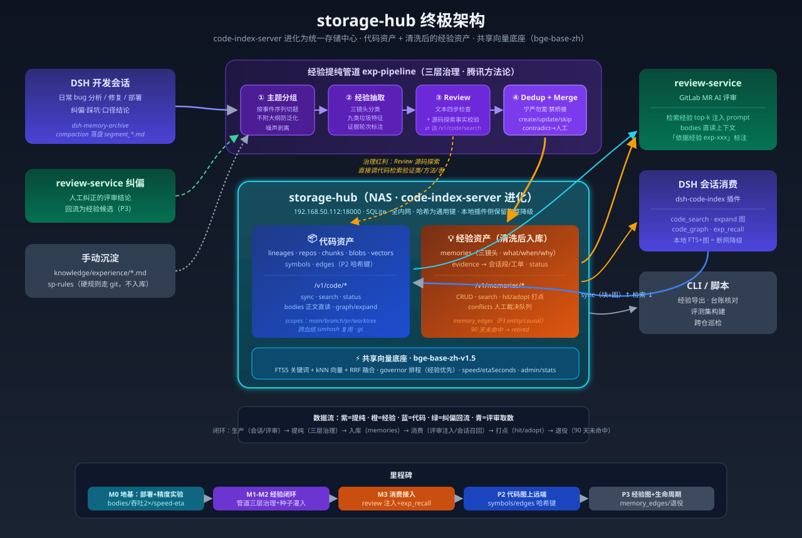

# storage-hub：code-index-server 进化为存储中心（架构 v3）

> 状态：规划稿 v2（2026-11-19）。取代 `archive/plan-code-index-0.17.md` 与 `archive/plan-experience-system.md`
> 中「服务端」相关的部分；两份文档的插件侧 / 管道侧内容仍有效，并入本文引用。
> 定位：**一个自建内网服务，两类资产的统一存储/检索/治理底座**。
> 架构图：
>
> **v2 修订（2026-11-19）：会话资产（archives/segments 表）从服务端终态中移除**。
> 归档原文不上传——管道直接读本地 `~/.dsh/archive/`（插件已是事实源，上传=重复存储+隐私面扩大）；
> 服务端只存**清洗治理后的经验**（memories）。§2.2 保留为管道内部约定，不再是服务端表。

## 0. 为什么值得合（先回答「为什么不分开建两个服务」）

| 论点 | 说明 |
|---|---|
| 检索基建同构 | 两类资产全是「文本 → 切块 → 向量 + 关键词 → RRF」；bge/FTS5/kNN/scopes/stats 已在生产跑，分开建=两份重复运维 |
| 治理链路同构 | 代码块要 Review（源码探索），经验要 Review/Dedup/Merge——同一套「候选→治理→入库→打点→退役」骨架 |
| 消费端重叠 | review-service 与 DSH 会话同时要「代码上下文 + 经验」；一个端点一次拿齐，跨库 join 不存在 |
| 数据互链 | 经验的 evidence 指向会话段与代码块（工单号/标识符）；同一 SQLite 里外键/图边天然可查，分库则断 |
| 成本 | NAS 已有容器与卷；扩表 + 扩端点的边际成本 ≪ 新服务 |

不合的风险也要说清：**单点**（服务挂 → 代码检索/经验全挂）。对策：两类资产读写
路径隔离（独立表组 + 独立端点前缀），故障域不扩散；本地插件侧保留代码块的完整降级。

## 1. 终态架构

```text
                    ┌────────────────────── NAS: storage-hub ──────────────────────┐
                    │            （code-index-server 进化，两类资产）               │
                    │                                                             │
  代码资产（已有+P2）  │                       经验资产（新增）                        │
  ┌────────────────┐ │  ┌───────────────────────────────────────────────────┐     │
  │ lineages/repos │ │  │ memories（三镜头/what-when-why/evidence/stats）   │     │
  │ chunks/blobs   │ │  │ memory_edges ←P3（entity/temporal/causal）       │     │
  │ vectors        │ │  └──────────────────────┬────────────────────────────┘     │
  │ symbols/edges  │ │                         │                                  │
  │   ←P2 哈希键    │ │   /v1/memories/*：CRUD·search·hit/adopt·conflicts        │
  └───────┬────────┘ │                                                             │
          │          │   /v1/code/*：sync·search·status·bodies·graph/expand        │
          │          └─────────────┬───────────────────────────────────────────────┘
          │                        │
  ┌───────▼────────────────────────▼──────────────────────────────────┐
  │ 共享底座：bge 嵌入（吞吐优化已就绪待部署）· FTS5 · kNN · scopes/stats │
  │ 治理框架：候选→Review→Dedup→Merge→入库→打点→退役（两类资产共用骨架）│
  └────────────────────────────────────────────────────────────────────┘
       ▲                                          ▲
       │                                          │
  ┌────┴─────────────┐              ┌─────────────┴──────────────┐
  │ dsh-code-index   │              │ review-service             │
  │ 插件（代码检索/   │              │ （经验注入评审 + 上下文      │
  │ 图/本地降级）     │              │  bodies 直读）              │
  └──────────────────┘              └────────────────────────────┘
       ▲                                          ▲
       │      exp-pipeline（离线治理管道，读本地 ~/.dsh/archive/，
       └──────产出清洗后的经验写 memories；评审纠偏回流 P3）────────┘
```

## 2. 两类资产的存储设计

### 2.1 代码资产（现有 5 表 + P2 两表）

现有不动：`lineages/repos/chunks/blobs/vectors`，作用域、simhash 跨血统复用、gc 全部沿用。
P2 新增（本地图的远端镜像，哈希为通用键）：

```sql
symbols(lineage_id, hash, name, kind, path, start)      -- 声明符号
edges(lineage_id, src_hash, dst_hash, type, weight)     -- imports/calls/overrides/
                                                        -- mapper_stmt/table_ref
```

- sync payload 扩展 `graph` 段，幂等 upsert；gc 随 blob 级联。
- 查询：`/v1/code/graph/expand`（服务端出邻居，review-service 免装插件）。

### 2.2 会话资产 → v2 移除（管道内部约定）

归档原文不上传服务端。管道（exp-pipeline Stage A）直接读本地 `~/.dsh/archive/<sessionId>/segment_*.md`：

```text
原始 segment（md，含 verbatim 轮次）
  → 主题分组（按事件序列切题；不附大纲——腾讯实测：大纲引导泛化，放大垃圾）
  → 噪声剥离（"继续/重试/换个方式"、失败路径录像、无结论调试）
  → 事实锚定（工单号/文件路径/标识符/SQL 抽取）
  → 产出「清洗后的经验候选」→ Stage B 三层治理 → 只把结果写服务端 memories
```

收益：服务端无会话原文（隐私面最小化）、无重复存储、memory-archive 插件零改动；
代价：跨会话取证仍靠本地（session_search / attic 工具），hub 不提供归档检索。

### 2.3 经验资产（memories，新增两表）

沿用 archive/plan-experience-system.md §3.1 的条目 schema（三镜头/what-when-why/evidence/status/stats），
落成服务端表：

```sql
memories(
  id text primary key,            -- exp-000123
  repo text,                      -- 仓库名或 global
  lens text,                      -- jargon|index|logic
  what text, when_ text, why text,
  evidence json,                  -- [{archive_ref}|{issue}|{mr}]
  status text,                    -- active|retired|conflicting
  source text,                    -- pipeline|manual|review-feedback
  stats_hits integer, stats_adopted integer, last_hit_at integer,
  created_at integer, updated_at integer
);
memory_edges(                     -- P3：mnemon 四边思想的实体版
  src_id text, dst_id text, type text, weight real,
  primary key(src_id, dst_id, type)
);
```

- 治理链路（Stage B，腾讯三层）：抽取（九类垃圾特征）→ Review（**源码探索用 /v1/code/search
  验证类/方法/表存在**——经验与代码在同一服务里，这正是合并的红利）→ Dedup（宁严勿宽、禁桥接）
  → Merge（create/update/skip/contradict，唯一目标判定前置）。
- 打点：`POST /v1/memories/{id}/hit` / `/adopt`；90 天未命中 → retired 候选；contradict → 人工队列。
- 查询：`POST /v1/memories/search {q, repo?, lens?, top_k}` → 完整条目（review-service 注入用）。

### 2.4 向量化查询加速（两类共用）

| 资产 | 向量 | 关键词 | 融合 |
|---|---|---|---|
| 代码块 | blobs 正文 → vectors（现有） | FTS5（现有） | RRF（现有） |
| 会话段 | 清洗后正文（清洗前不嵌，省 60%+ 算力） | FTS5 | RRF |
| 经验条目 | what+when 拼接正文 | FTS5 | RRF |

嵌入排程统一走 governor（吞吐优化已落地：分桶窗口 1.96×、同批去重、截止时间限速、
speed/etaSeconds 已加）；两类资产共享同一 `rate` 配额，**经验优先级高于代码补嵌**
（增量代码块可以等，管道产出要及时可查）。

## 3. 端点总表（终态）

| 前缀 | 端点 | 状态 |
|---|---|---|
| `/v1/code/*` | sync / search / status / **bodies** / graph-expand / scopes | bodies 已实现未部署；graph P2 |
| `/v1/memories/*` | CRUD / search / hit / adopt / conflicts | 新增 |
| `/v1/admin/*` | stats（两类资产分列）/ rate / gc / pause | 扩展 |
| 旧路径 | `/v1/namespaces/{ns}/...` 全部保留（插件兼容期） | 不动 |

## 4. 客户端改动清单

| 客户端 | 改动 | 期 |
|---|---|---|
| exp-pipeline | Stage A 直接读本地 `~/.dsh/archive/`（无上传）；Stage B 三层治理后写 memories | M2 |
| dsh-code-index | sync 带图（P2）；检索优先远端 expand | P2 |
| review-service | 经验 top-k 注入（/v1/memories/search）+ 上下文正文（/v1/code/.../bodies） | review 批次 |
| DSH 会话 | `exp_recall` 工具（M3）；归档检索继续走本地 session_search | M3 |

## 5. 里程碑

| 期 | 内容 | 验收 |
|---|---|---|
| **M0 地基**（先做，半天） | 部署积压的全部服务端改动：bodies 端点 + 吞吐 2× + speed/etaSeconds + **模型精度实验（fp32/int8 实测选型）** → 一次重启到位 | erp-pos 全量嵌入 ≤40min；status 可见 speed/eta |
| **M1 经验闭环**（2-3 天） | memories 表 + CRUD/search/hit + exp-pipeline（A 本地清洗分层 → B 三层治理）+ 223 条种子灌入 | 3 个历史会话跑批：垃圾率 <30%，contradict 进队列 |
| **M2 消费接入**（1-2 天） | review-service 注入经验 + bodies 直读；DSH `exp_recall` | MR 报告出现「依据经验 exp-xxx」；影子对比 |
| **P2 代码图上远端**（1-2 天） | symbols/edges 表 + sync graph 段 + graph-expand 端点 | erp-pos mapper 三角服务端可达 |
| **P3 经验图+回流**（按需） | memory_edges（entity/temporal/causal）+ 遍历端点；评审纠偏回流 | 关联召回演示 |

M0 是其余一切的前提（吞吐不解决，经验的嵌入排队会压垮体验）。

## 6. 风险与对策

| 风险 | 对策 |
|---|---|
| 单点：hub 挂 → 两类资产全不可查 | 表组/端点隔离故障域；代码块本地完整降级（现有）；经验可整库导出 md |
| 隐私：经验含内网路径/工单 | 全内网部署（现状即如此）；evidence 只存引用（会话号/工单号），不存归档原文；管道写入前 redact |
| 嵌入排程饥饿：代码补嵌挤占经验 | governor 加资产优先级（memories > code 增量） |
| 治理质量翻车（90% 垃圾教训） | 三层治理从 M1 第一天就上；评测集（223 条标注）先行；contradict 永远人工 |
| 与 mnemon 的关系混乱 | 明确不装 mnemon 本体；只借「分层/预算/可见性/四边」思想，本文即对应实现 |

## 7. 与既有文档的关系

- `archive/plan-experience-system.md`：§3 存储/端点被本文 §2.3 取代；§4 管道细节（prompt/评测集）继续有效。
- `archive/plan-code-index-0.17.md`：P1.5/P1/P2.5 已完成或并入本文；P2（图上远端）并入本文 P2。
- `docs/bodies.md`：即本文 `/v1/code/bodies` 的契约（已实现）。
- mnemon 对照结论（只借思想不装本体）不变。
